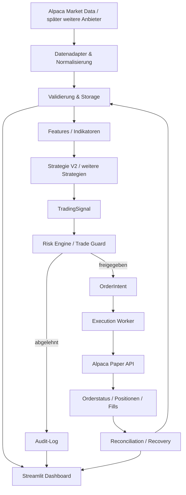

# Aktien-Chatbot – Master-Projektplan & technische Anforderungen

**Dokumentversion:** 1.2  
**Stand:** 17. November 2026  
**Status:** Verbindliche gemeinsame Planungsgrundlage mit Aufgaben-Checklisten, reproduzierbarer Validierung und wirtschaftlichen Freigabekriterien  
**Repository:** privates GitHub-Repository `aktien-chatbot`  
**Team:** 2 Entwickler (Person A = Data/Quant, Person B = Risk/Execution/Platform)

> **Zweck:** Dieses Dokument hält Ziel, Anforderungen, Architektur, Schnittstellen, Sicherheitsvorgaben, Aufgabenverteilung, Sprintplanung, Entscheidungen und Abnahmekriterien an einer zentralen Stelle fest. Es dient als gemeinsames Nachschlagewerk. Der tatsächliche Implementierungsstand wird über Git-Commits und Tests nachgewiesen – geplante Bausteine gelten nicht automatisch als implementiert.

## 1. Projektziel und Produktumfang

Entwicklung eines **eigenständigen, erweiterbaren Python-Trading-Bots** zur Analyse von US-Aktien und ETFs, zur Erzeugung reproduzierbarer Kauf-/Verkaufssignale sowie zur späteren automatischen Orderausführung **zunächst ausschließlich im Alpaca-Paper-Trading-Konto**. Eine Streamlit-Oberfläche stellt Ergebnisse, Positionen, Risiko- und Betriebsstatus dar. Zwei Entwickler arbeiten über ein privates GitHub-Repository am selben Codebestand.

### 1.1 Verbindlicher MVP-Umfang

- **Handelsstil:** Swing-Trading auf Basis abgeschlossener US-Tageskerzen; Positionen typischerweise mehrere Tage bis Wochen.
- **Erstes Universum:** `AAPL`, `MSFT`, `NVDA`, `AMZN`, `GOOGL`; `SPY` dient als Marktfilter und Benchmark.
- **Marktdaten:** Alpaca (für den bestehenden Prototyp IEX-Feed, mit explizitem Qualitäts-/Lizenzhinweis).
- **Strategie:** Bestehende V2 als reproduzierbare Baseline; Regeln werden nur versioniert und nach Tests verändert.
- **Broker:** Alpaca Trading API mit `paper=True` (erste Stufe nur lesend; spätere Stufe Paper-Orderausführung).
- **Risikokontrolle:** Unabhängige und ausnahmslos zu durchlaufende Risk Engine.
- **Betrieb:** Getrennter Trading-Worker/Runner und Streamlit-UI; UI darf nicht eigenständig Broker-Orders senden.
- **Zusammenarbeit:** Zwei Personen, **direkte Commits/Pushes auf `main`, ohne verpflichtende Pull Requests und ohne Code-Reviews**. Automatisierte Tests bleiben obligatorisch.
- **Live-/Echtgeldhandel:** Nicht Bestandteil des MVP; technisch gesperrt, keine hinterlegte Live-Orderfunktion.

### 1.2 Nicht im MVP / spätere Optionen

- Intraday-/Daytrading mit 5-, 15- und 60-Minuten-Kerzen, anschließend bei Bedarf weitere Intervalle.
- IBKR als zusätzlicher Broker und Datenanbieter; erst nach technischer und wirtschaftlicher Bewertung.
- Europäische Aktien, Short-Trading, Futures, Optionen, CFDs und Hebelprodukte.
- XGBoost/LightGBM und KI-gestützte Zusatzsignale; nur nach Out-of-Sample-Mehrwertnachweis.
- PostgreSQL/TimescaleDB bei gemeinsamer Serverinfrastruktur bzw. wachsender Datenmenge.
- **Stock3 ist weder Anforderung noch Auswahlkriterium.** Eine Integration wird nur erwogen, wenn sie nachweislich sinnvoll, rechtlich zulässig und wirtschaftlich gerechtfertigt ist. Keine Abhängigkeit oder Platzhalterimplementierung erforderlich.

## 2. Architekturentscheidungen (Architecture Decision Records)

| ID | Entscheidung | Grund / Konsequenz |
|---|---|---|
| ADR-001 | Modularer Python-Monolith | Für zwei Entwickler leichter als Microservices zu testen, betreiben und erweitern. |
| ADR-002 | Alpaca Paper als erste Orderplattform | Bestehender funktionierender Zugang; kostengünstiger Entwicklungseinstieg. |
| ADR-003 | Daten-, Strategie-, Risiko- und Ausführungslogik strikt trennen | Austauschbare Anbieter/Strategien; kein ungeprüfter Orderweg. |
| ADR-004 | Swing-Trading zuerst | Tageskerzen und bestehende V2 ermöglichen reproduzierbaren MVP. |
| ADR-005 | Kein LLM als unmittelbarer Orderentscheider | Feste, prüfbare Signal- und Risikoregeln bestimmen Orderzulässigkeit. |
| ADR-006 | Streamlit = Dashboard, Worker = Trading | Seitenaufrufe und UI-Neustarts dürfen keine Orders auslösen. |
| ADR-007 | Entwicklung auf `main` mit direkten Pushes | Teamentscheidung; Synchronisation und Tests ersetzen nicht die Notwendigkeit sauberer Commits. |
| ADR-008 | SQLite lokal, PostgreSQL später | Keine frühzeitige Betriebs-/Datenbankkomplexität. |
| ADR-009 | Stock3 rein optional | Kein technischer oder kommerzieller Zwang zur Nutzung. |
| ADR-010 | Echtgeldmodus fehlt im MVP technisch | Kein versehentliches Senden realer Orders. |

**Änderungen an diesen Entscheidungen** müssen in diesem Dokument mit Datum, Begründung und Folgen dokumentiert werden.

## 3. Systemarchitektur und Datenfluss



**Zentraler Grundsatz:** Daten → Strategie → Signal → Risikoentscheid → Orderplan → später Paper-Ausführung. **Keine direkte Verbindung `OpenAI/Streamlit/Strategie → submit_order`.**

### 3.1 Verantwortlichkeiten und Betriebsregeln

| Baustein | Verantwortung | Externe Orders? |
|---|---|---|
| `data` | Rohdaten abrufen, Herkunft/Zeiten aufzeichnen, normalisieren, validieren | Nein |
| `features` | EMA, ATR, RSI und spätere technische Features ohne Zukunftsdaten | Nein |
| `strategies` | Deterministische Signale und Begründungen mit Versionsnummer | Nein |
| `backtesting` | Historische Orders simulieren, Kosten und Risiken berichten | Nein |
| `risk` | Positionsgröße, Kapital-/Exposure-/Verlust-/Datenregeln, Kill Switch | Nein |
| `execution` | Später alleiniger Paper-Orderweg, Idempotenz, Status und Reconciliation | Nur nach Freigabe, nur Paper |
| `storage` | Kurs-/Signal-/Risiko-/Orderereignisse nachvollziehbar speichern | Nein |
| `monitoring` | Logs, Alarme, Neustart- und Health-Zustand | Nein |
| `app.py` | Benutzeroberfläche, Read-only-Ergebnisse, kontrollierte Einstellungen | Nein |
| `ai` (optional) | Analyse und Erklärungen, kein direkter Orderpfad | Nein |

### 3.2 Datenbank & Nachvollziehbarkeit

**Kurzfristig:** CSV-Historie bleibt als Eingang/Baseline erhalten; SQLite für eventuelle Laufzeit-/Orderprotokolle vorbereiten. **Später:** PostgreSQL als zentraler, transaktionaler Store auf einem gemeinsam betriebenen Server; TimescaleDB nur bei echtem Bedarf.

Geplante logische Entitäten: `instruments`, `market_bars`, `strategy_versions`, `trading_signals`, `risk_decisions`, `order_intents`, `orders`, `executions`, `positions`, `account_snapshots`, `system_events`.

Jede Kursreihe benötigt: Symbol/Instrument-ID, Intervall, Börsenzeitstempel mit Zeitzone, Datenquelle/Feed, OHLCV, Vollständigkeitskennzeichen, ggf. Adjustment-Status. Signale enthalten Bar-Zeitpunkt und Strategieversion. Orders erhalten eindeutige Client-IDs und unveränderliche Statusereignisse.

## 4. Repo-Struktur: vorhanden vs. Ziel

### 4.1 Bestehender lokaler Stand (bekannt aus Projektverlauf; tatsächliche Installation prüfen)

```text
aktien-chatbot/
├── app.py
├── market_data.py
├── strategy.py
├── strategy_v2.py
├── backtest.py
├── backtest_v2.py
├── trade_strategy.py
├── audit_v2.py                 # falls bereits übernommen
├── test_alpaca.py              # früherer manueller Paper-Ordertest; nicht automatisieren!
├── .env                        # lokal, niemals committen
├── .gitignore
├── data/                       # lokale Kursdaten
└── backtest_results/           # lokale Ergebnisdateien
```

### 4.2 Zielstruktur (Sprint-1-Paket soweit beschrieben / später zu ergänzen)

```text
aktien-chatbot/
├── README.md
├── PROJECT_PLAN.md                 # dieses Dokument
├── app.py                          # bestehendes Streamlit-Dashboard
├── market_data.py                  # bestehender Downloader, vorerst erhalten
├── strategy_v2.py                  # bisherige Baseline, vorerst erhalten
├── backtest_v2.py                  # bisherige Baseline, vorerst erhalten
├── .env                            # NUR lokal
├── .env.example
├── .gitignore
├── pyproject.toml
├── requirements.txt
├── .github/workflows/tests.yml
├── .github/workflows/validate-task.yml  # manuell startbare Prüfungen
├── docs/
│   ├── START_HIER.md
│   ├── INTERFACES.md
│   └── decisions/                 # später weitere Architekturentscheidungen
├── trading_bot/
│   ├── __init__.py
│   ├── config.py
│   ├── models.py
│   ├── dry_run.py
│   ├── data/
│   │   ├── __init__.py
│   │   ├── csv_loader.py
│   │   └── alpaca_market_data.py  # später
│   ├── features/
│   │   └── indicators.py         # später
│   ├── strategies/
│   │   ├── __init__.py
│   │   └── v2_bridge.py
│   ├── backtesting/
│   │   ├── engine.py             # später
│   │   └── reports.py            # später
│   ├── risk/
│   │   ├── __init__.py
│   │   └── guard.py
│   ├── execution/
│   │   ├── __init__.py
│   │   ├── interfaces.py
│   │   ├── alpaca_readonly.py
│   │   ├── alpaca_paper.py       # erst Folgesprint, nur Paper
│   │   └── reconciliation.py     # erst Folgesprint
│   ├── storage/                  # erst nach Definition des Datenmodells
│   ├── monitoring/               # später
│   └── runner.py                 # später, unabhängig von Streamlit
├── scripts/
│   └── validate_task.py          # Task-bezogene Prüfungen ohne Orderversand
├── validation_reports/           # generiert, nicht committen
├── tests/
│   ├── test_contracts.py
│   ├── test_data.py
│   ├── test_risk.py
│   └── test_v2_bridge.py
├── data/                         # lokal / ignoriert
├── backtest_results/             # lokal / ignoriert
├── validation_reports/           # generiert / ignoriert
└── legacy/                       # erst nach erfolgreicher Migration
```

**Nicht vorschnell verschieben:** Alte Dateien erst nach erfolgreichem Migrations-/Regressionstest nach `legacy/` verschieben. Vorhandene Konfigurationsdateien beim Entpacken eines Startpakets zusammenführen statt blind überschreiben.

## 5. Einheitliche Schnittstellen (verbindlicher Vertrag)

Sprint 1 stellt unter `trading_bot/models.py` diese unveränderlichen Python-Datentypen bereit:

| Typ | Aktueller Vertrag | Bedeutung |
|---|---|---|
| `Side` | `BUY`, `SELL`, `HOLD` | Standardisierte Handelsrichtung |
| `MarketBar` | `symbol`, `timestamp` (timezone-aware), `timeframe`, `source`, `open`, `high`, `low`, `close`, `volume`, `complete` | Einheitliche OHLCV-Kerze |
| `TradingSignal` | `signal_id`, `symbol`, `side`, `bar_date`, `strategy_version`, `reason`, `suggested_stop?` | Strategieentscheidung, **keine Order** |
| `OrderIntent` | `intent_id`, `signal_id`, `symbol`, `side`, `quantity`, `order_type='market'` | Geplanter Auftrag, **noch nicht an Broker übermittelt** |
| `RiskDecision` | Risikofreigabe/Ablehnung inkl. Grund, Stückzahl, geplantes Risiko | Ergebnis eines unabhängigen RiskGuard |
| `BrokerReader` | `read_summary()` | Ausschließlich lesender Paper-Kontozugriff |

**Ergänzungen für Folgesprints:** `BrokerOrder`, `ExecutionFill`, `AccountSnapshot`, `PositionSnapshot`, orderbezogene Idempotenz-ID und explizite Versions-/Zeitfelder. Schnittstellenänderungen müssen mit Tests und Doku konsistent erfolgen.

**Hinweis zum aktuellen Startpaket:** `csv_loader.py` liefert derzeit ein validiertes pandas DataFrame, keine Liste von `MarketBar`-Instanzen. Die Angleichung erfolgt in einem späteren Arbeitspaket.

## 6. Funktionale Anforderungen (FR)

| ID | Anforderung | Zielstufe | Akzeptanzbedingung |
|---|---|---|---|
| FR-01 | US-Tageskurse AAPL/MSFT/NVDA/AMZN/GOOGL/SPY laden | Sprint 1 | Alle CSVs lesbar, Datum korrekt, Validierung erfolgreich |
| FR-02 | Abgeschlossene Kerzen, Plausibilität, Duplikate und fehlende Daten erkennen | Sprint 1–2 | Invalides Material wird gemeldet/gesperrt |
| FR-03 | V2-Signal aus vorhandener Strategie erzeugen | Sprint 1 | Wiederholbare `TradingSignal`-Objekte mit Signal-ID/Version |
| FR-04 | Risiko unabhängig von Strategie berechnen | Sprint 1 | Abgelehnte Fälle erzeugen keinen Orderplan |
| FR-05 | Alpaca-Paper-Kontostand/Positionen/offene Orders lesen | Sprint 1 | `paper=True`, keine `submit_order`-Methode im Read-only-Adapter |
| FR-06 | V2-Backtest unverändert reproduzieren | Sprint 1–2 | Vergleich mit Baseline innerhalb dokumentierter Toleranz |
| FR-07 | SPY-Benchmark und Out-of-Sample-Auswertung | Sprint 2 | Gleiches Zeitfenster, Daten-/Dividendenannahmen offengelegt |
| FR-08 | Zulässigen OrderIntent erzeugen | Sprint 1–2 | Eindeutige ID; vollständiger Audit-Trail |
| FR-09 | Paper-Orders korrekt und einmalig senden | Sprint 3 | Idempotenz, Status- und Fill-Nachführung getestet |
| FR-10 | Nach Neustart Orders/Positionen reconciliieren | Sprint 3–4 | Keine unkontrollierte erneute Order |
| FR-11 | Selbstständiger Paper-Trading-Zyklus | Sprint 4 | Worker läuft unabhängig von UI mit Börsenkalender/Healthchecks |
| FR-12 | Dashboard für Signale, Risiko, Orders, Performance | Sprint 4 | Status transparent, keine direkte Orderberechtigung der UI |
| FR-13 | Zusätzliche Strategien/Intraday-Daten | später | Eigenständige Tests und historische Validierung |
| FR-14 | Brokerwechsel möglich | später | Adapter erfüllt identischen Brokervertrag |
| FR-15 | Optionale KI-/News-Komponente | später | Messbarer Mehrwert, kein direkter Orderzugriff |

## 7. Nichtfunktionale Anforderungen (NFR) und Sicherheit

- **NFR-01 Reproduzierbarkeit:** Datenstand, Strategieversion, Parameter, Kostenmodell, Zeitzone und Testzeitraum protokollieren.
- **NFR-02 Keine Look-ahead-Verzerrung:** Tagesabschluss-Signale erst am Folgetag handeln; Intraday nur abgeschlossene Intervalle.
- **NFR-03 Datenqualität:** Fehlende/veraltete/ungültige Kurse und API-Probleme sperren neue Orders.
- **NFR-04 Geheimnisse:** `.env`, Tokens, Broker-/OpenAI-Keys niemals committen, loggen oder im Chat teilen; `.env.example` nur Platzhalter.
- **NFR-05 Paper-only:** Kein Live-Key im ausführenden Prozess, Broker-Client immer `paper=True`; Live-Modus nicht implementiert.
- **NFR-06 Single Writer:** Nur ein Worker darf pro Strategie und Brokerkonto Orders erzeugen.
- **NFR-07 Idempotenz:** Signale/Orderversuche erhalten eindeutige IDs; nach Timeout zuerst Brokerstatus prüfen.
- **NFR-08 Recovery:** Restart-Reconciliation; unbekannte Positionen/Orders blockieren neue Orders bis zur Klärung.
- **NFR-09 Testbarkeit:** Daten, Strategie und Risiko vollständig offline testbar; API-Adapter mockbar.
- **NFR-10 Monitoring:** Strukturierte Logs, Healthchecks, Alarme und dokumentierter Kill Switch.
- **NFR-11 Zugriff:** Beide Entwickler mit eigenen GitHub-Konten; auf gemeinsamem Hosting getrennte Nutzerkonten und zentrale Secret-Verwaltung.
- **NFR-12 Kostenkontrolle:** API-Budget und Anbieterlimits überwachen; kostenlose Dienste können Daten-/Nutzungseinschränkungen haben.

### 7.1 Verbindlicher Paper-Risikorahmen für 25.000 € Planungsstartkapital (noch nicht vollständig implementiert)

| Regel | Vorschlag |
|---|---|
| Geplantes Risiko je Trade | **0,25 %** des aktuellen Equity-Werts (bei 25.000 €: 62,50 €) |
| Geplantes Gesamtrisiko offener Positionen | **max. 1,0 %** (bei 25.000 €: 250 €; als Summe der geplanten Stop-Verluste) |
| Maximaler Anteil je Position | **20 %** (bei 25.000 €: 5.000 €), keine Hebelwirkung |
| Maximal gleichzeitig offene Positionen | 3 |
| Tagesverlustgrenze | **1,0 %** vom Equity-Referenzwert des Tages; keine neuen Positionen nach Überschreitung |
| Wochenverlustgrenze | **2,5 %** vom Equity-Referenzwert der Woche; keine neuen Positionen nach Überschreitung |
| Veraltete Daten, offener ungeklärter Orderstatus, Kill Switch | Keine neuen Käufe |
| Stop-Plan | Vor jeder Freigabe erforderlich; Gebühren im geplanten Risiko einrechnen |
| Maximaler Gesamt-Kapitaleinsatz | **60 %** (3 Positionen × maximal 20 %), Rest kann Cash bleiben |
| Drawdown-Ampel (vom Equity-Höchststand) | **−10 % Warnung**, **−12 % neue Einstiege sperren**, **−15 % Paper-Strategie stoppen und untersuchen** |
| Echtgeld | Gesperrt |

Ein Stop garantiert keinen maximalen Verlust; Kurslücken und Ausführungen können schlechter als geplant sein. **Bei US-Dollar-Handel alle EUR-Beispiele zum jeweiligen EUR/USD-Kurs in Kontowährung umrechnen; Risikoberechnung muss auf tatsächlicher Account-Equity erfolgen.** Diese Limits sind **noch nicht sämtlich in Sprint 1 umgesetzt**. Bestehende V2-Backtests verwenden historisch 0,5 % pro Trade; die neuen 0,25 % sind eine **künftige Paper-Risikopolitik**, keine rückwirkende Beschreibung der Backtest-Engine.

## 8. Broker-/Datenquellenstrategie

### 8.1 Aktuelle Wahl

- **Alpaca Paper Trading** ist der einzige für den MVP eingeplante Broker.
- Konto-/Positionsabfragen werden in Sprint 1 isoliert; Orderversand erst später nach Tests.
- Kostenloser IEX-Marktdatenfeed ist **nicht** der vollständige konsolidierte US-Marktfeed. Datenquelle für Backtests dokumentieren, nicht unkritisch als Marktgesamtvolumen interpretieren.
- Bestehendes `market_data.py` speichert Tagesdaten im Format `data/{SYMBOL}_1day.csv` mit `timestamp_ny`.
- `SPY` ist für den Filter nötig; SPY-Benchmark darf erst nach gleichartigem Datenzeitraum und nachvollziehbarer Adjustierungs-/Dividendenbehandlung interpretiert werden.

### 8.2 Spätere Anbieterentscheidung

IBKR, alternative lizenzierte Marktdaten und weitere Broker nur aufnehmen, wenn Märkte, Preise, Ausführungsqualität, Datenrechte oder Betrieb es rechtfertigen. **Stock3 nicht priorisieren** und keine Stock3-API als Voraussetzung formulieren.

## 9. Backtesting-Qualitätsstandard

- V2 zunächst als unveränderte Baseline archivieren: im bisherigen Test rund **50.000 USD Startkapital**, **+0,35 % Rendite**, **−4,46 % maximaler Drawdown**, **20 abgeschlossene Trades**; Zeitraum/Ergebnisse anhand der jeweiligen Daten neu reproduzieren.
- Bisherige Analyse zeigt geringe durchschnittliche Kapitalbindung und starke Abhängigkeit von einzelnen Gewinntrades. Kein Nachweis robuster Profitabilität.
- Signale immer nur aus bis dahin bekannten Daten erzeugen; Ausführung zeitlich erst danach.
- Kosten, Spread, Slippage, Gap-Risiko, Stop-Reihenfolge, Teilfills und fehlende/angepasste Daten explizit modellieren.
- Buy-and-Hold/Benchmark mit gleichem Zeitraum vergleichen, **nicht** als risikogleiche Strategie darstellen, wenn das Exposure unterschiedlich ist.
- Train/Test-Trennung und Walk-forward-Prüfungen; keine Parameteroptimierung auf der späteren Testperiode.
- Report: Rendite, maximale Drawdown, Trefferquote, Profit Factor, Expectancy, Holding Days, Exposure, Kosten, Einzeltitelbeiträge, offene Positionen.
- Nicht nur profitable Tests zählen: schwache Phasen und fehlgeschlagene Versuche dokumentieren.

### 9.1 Wirtschaftliches Zielbild und Erfolgsmaßstab (Beschluss vom 17.11.2026)

**Planungskapital:** **25.000 €**. **Zielrendite:** **10–15 % p. a.** als *langfristige, annualisierte Zielspanne*, nicht als garantierte Rendite, nicht als Prognose und ausdrücklich nicht als Pflichtwert jedes einzelnen Kalenderjahrs.

| Kennzahl | Verbindliche Projektregel | Bei 25.000 € (nur Rechenbeispiel) |
|---|---|---:|
| Strategisches Ziel | **10–15 % CAGR** nach Handelskosten und laufenden zurechenbaren Betriebskosten, **vor persönlichen Steuern** | **2.500–3.750 €/Jahr** bei konstantem Anfangskapital |
| Wirtschaftliche Mindesthürde | **8 % CAGR** unter gleichen Kostenannahmen **und** positives risikobereinigtes Mehrwerturteil gegenüber Alternativen; darunter Strategie **nicht als wirtschaftlich freigabereif** deklarieren | **2.000 €/Jahr** |
| Ambitionierter Zielpunkt | **12 % CAGR** als Modellierungs-/Planungswert; keine Nachweispflicht aus einer einzelnen Backtest-Periode | **3.000 €/Jahr** |
| Laufende Kosten | Gebühren, Spread, Slippage, Daten, Hosting und betriebsbezogene Software separat belegen; **keine stillschweigend angenommenen Nullkosten** | Beispiel: 300–600 €/Jahr *nur als Szenario, nicht als ermittelter Preis* |
| Benchmark | **SPY Total Return** auf demselben Zeitraum und gleicher Währungsbasis; zusätzlich Cash-/Geldmarkt-Alternative und Risiko-/Exposure-Unterschied darstellen | Kein festes Alpha versprechen |
| Verbotene Abkürzung | Erhoffte Rendite **nicht** durch höheres Hebelrisiko oder Lockerung der Drawdown-Grenzen erzwingen | — |

**Rechenregel:** Handelsrendite und Betriebsrendite strikt unterscheiden. `CAGR_gross` berücksichtigt die modellierten Handelskosten; `CAGR_economic` berücksichtigt zusätzlich zurechenbare laufende Betriebskosten und ggf. Wechselkosten. Steuern werden **separat** als individuelle Nach-Steuer-Szenarien berichtet. 25.000 € Planungskapital sind nicht identisch mit den historischen **50.000 USD** der bisherigen V2-Tests. Backtests deshalb in tatsächlicher Kontowährung mit dokumentierter EUR/USD-Umrechnung oder als klar bezeichnetes USD-Szenario neu durchführen. Ein USD-Ergebnis darf nicht ohne Währungsbetrachtung als EUR-Rendite ausgegeben werden.

**Wirtschaftliches Beispiel (keine Prognose):** 10 % auf 25.000 € entspricht 2.500 € vor persönlicher Steuer, **wenn** diese 10 % schon alle vorgesehenen laufenden Kosten enthalten. Bei 3.000 € Handelsgewinn und 500 € realen Fixkosten wären es 2.500 € wirtschaftlicher Gewinn (= 10 %). Für die Entscheidung ist auch der Entwicklungs-/Wartungsaufwand beider Personen relevant; dieser wird in Stunden erfasst und optional mit einem Opportunitätskostensatz bewertet, **nicht** als bereits bezahlter Aufwand erfunden.

### 9.2 Kapital- und Risikoanforderungen (Gates, nicht Performanceversprechen)

- **Start:** 25.000 € Planungsgröße; im MVP ausschließlich Paper. Kontowährung und FX-Umrechnung in jedem Bericht angeben.
- **Trade-Risiko:** zunächst 0,25 % der aktuellen Account-Equity, geplante Stop-Entfernung **inklusive Ausführungskosten**; keine Order ohne gültigen positiven Stop-Preis.
- **Gleichzeitige Risiken:** Summe geplanter Stop-Verluste aller Positionen plus neuer Position ≤ 1,0 % Equity; höchstens 3 Positionen; max. 20 % Equity je Einstieg und 60 % gesamtes Brutto-Exposure; keine Hebelprodukte oder Short-Positionen.
- **Verlustgrenzen:** 1,0 % intraday / 2,5 % pro Woche sperren **neue** Positionseröffnungen; bestehende Sicherheits-Exits bleiben zulässig. Bei 10 % Drawdown Warnung, bei 12 % keine neuen Einstiege, bei 15 % Strategie stoppen, Ursachen untersuchen und dokumentierte manuelle Wiederfreigabe verlangen. Drawdown relativ zum jeweiligen bisherigen Equity-Hoch und auf Basis einer fest definierten täglichen Portfolio-Bewertung bestimmen.
- **Fail closed:** fehlende/veraltete Daten, fehlende ATR, NaN/Inf, unbekannter Orderstatus, Broker-Reconciliation-Fehler und Kill Switch → keine neuen Orders. Gap-Verluste dürfen trotz Stop-Plan über dem Budget liegen; nicht als unmöglich darstellen.
- **Limits getrennt testen:** Die V2-Baseline mit 0,5 % historischer Trade-Risikoeinstellung und die neue 0,25-%-Paper-Regel sind zwei **getrennte, versionierte Szenarien**. Nicht unbemerkt vermischen.

### 9.3 Messbare Abnahmekriterien und Stufenfreigabe

Die Zielrendite ist eine **wirtschaftliche Zielsetzung**, kein automatisch beweisbarer Schwellenwert aus einer kurzen Stichprobe. Jede Stufe braucht einen dokumentierten Entscheid mit den Ergebnissen `PASS`, `REVIEW` oder `FAIL`.

| Gate | Erforderlicher Nachweis | Entscheidungsregel |
|---|---|---|
| **G0 – Backtest-Integrität (A3)** | Datenlücken-/Split-/Dividendenprüfung, reproduzierbare Daten- und Parameterstände; Signale t → Ausführung frühestens t+1; Gebühren-/Gap-/Stop-/Equity-Tests; SPY-Benchmark; bestehende Engine-Findings behoben | **PASS** erst bei reproduzierbarem Testlauf ohne kritischen Berechnungsfehler; sonst `REVIEW/FAIL` |
| **G1 – Strategie-Forschungsfreigabe** | Zeitlich getrennte Train-/Validation-/Test-Perioden, Walk-forward, unterschiedliche Marktphasen, mindestens zwei Kosten-Szenarien, Einzeltitel-/Einzeltrade-Konzentration, vollständiger Risiko-/Exposure-Bericht | Nur `PASS`, wenn keine Datenleckage und keine gravierende Einzelergebnis-Abhängigkeit ungeprüft bleibt; Zielkorridor und 8-%-Hürde **ausweisen**, nicht aus In-Sample-Erfolg ableiten |
| **G2 – Paper-Betrieb** | Vollständige RiskGuard-/Idempotenz-/Reconciliation-Tests, Broker nur `paper=True`, Kill-Switch-Test, Kosten-Logging, täglicher Equity-Report | Kritische Sicherheits- oder Orderfehler = `FAIL`; kein Paper-Orderbetrieb ohne G0 und technische Guard-Freigabe |
| **G3 – Beobachtete Paper-Evaluation** | Mindestens **3 Monate** stabiler Paper-Betrieb als *technisches* Mindestfenster, mit Trade-Logs, Slippage-/Kostenvergleich und dokumentierten Störungen; bei wenigen Trades **verlängern** | Mindestens 3 Monate alleine reichen **nicht**, um 10–15 % p. a. statistisch nachzuweisen; keine positive Freigabe bei Risiko-Verletzungen |
| **G4 – Wirtschaftliches Go/No-Go** | Annualisierte Netto-Kostenrendite aus angemessener OOS-Historie + Unsicherheit; max. Drawdown, Profit Factor, Konzentration, SPY/Cash-Vergleich, tatsächliche laufende Kosten und Aufwand | **GO nur zur nächsten *Paper-/Forschungsstufe***, wenn plausibel ≥ 8 % wirtschaftliche CAGR, Ziel 10–15 % als realistische Hypothese und vereinbarte Risikogrenzen; andernfalls überarbeiten / einstellen. **Keine Echtgeldfreigabe im MVP.** |

**Zusätzliche Diagnosegrößen (keine Erfolgs-Garantien):** Profit Factor ≥ 1,3 als *Forschungsziel* über ausreichend viele OOS-Trades; max. historischer Drawdown idealerweise ≤ 12 %, Stressgrenze 15 %; positive Netto-Expectancy nach Kosten; Stabilität über Teilperioden und bei höheren Slippage-Annahmen. Geringe Stichproben, wenige Trades oder ein dominierender Gewinner führen zu `REVIEW`, nicht zu automatischem `PASS`. SPY ist eine Vergleichsanlage mit anderem Risiko/Exposure; eine niedrigere absolute Rendite bei deutlich geringerem Risiko kann sinnvoll sein und muss entsprechend begründet werden.

**Referenzstand vom 17.11.2026 (nicht als wirtschaftlicher Nachweis freigegeben):** Rekonstruierte V2 mit 50.000 USD historischem Startkapital, ca. **+2,737 % gesamt** in rund drei Jahren (≈ **0,90 % p. a.**), Drawdown **−4,888 %**, 31 geschlossenen Trades, 1 offener Position, Trefferquote **29,03 %**, Profit Factor **1,372**. 23 Pytest-Tests und 9 Subtests wurden lokal als bestanden gemeldet. Ergebnis stark von einem GOOGL-Gewinntrade abhängig. **G0 noch offen**, weil die Engine-Risiko-/Datengrenzfälle und der Benchmark noch nicht vollständig geprüft sind; **G4 wirtschaftlich nicht bestanden**. Die Zahlen der älteren V2 (+0,35 % bei 50.000 USD) sind eine *andere* Implementierung/ein anderer Datenstand, nicht derselbe Test.

### 9.4 Konkrete zusätzliche Aufgaben – zwei Personen, keine Überlappungen

**Person A – Quant / Forschung**

- [ ] **ECO-A1** · 25.000-€-Szenario und 50.000-USD-Baseline getrennt und reproduzierbar backtesten; Kosten-/FX-Annahmen offenlegen. **Prüfung:** identischer Datenstand + gleiche Version → gleiche Equity-/Trade-Hashes oder reproduzierbare Kennzahlen.
- [ ] **ECO-A2** · Backtest-Härtung: Risiko inklusive Kosten, positiver Stop, OHLCV-/Datumsvalidierung, Fehlertage, Gap-Szenarien, Look-ahead-Regressionstests. **Prüfung:** neue gezielte Pytest-Grenzfalltests + gesamter Testsatz grün.
- [ ] **ECO-A3** · SPY-Total-Return- und Cash-Benchmark im selben Währungs-/Datumsraum; Exposure- und Risiko-Unterschiede berichten. **Prüfung:** Benchmark-Zeilen nachvollziehbar und Datenbehandlung dokumentiert.
- [ ] **ECO-A4** · OOS-/Walk-forward-Test, höhere Kosten, Einzeltrade-Ausschluss, Konzentration nach Symbol und Zeitabschnitt. **Prüfung:** automatisierter Report mit `PASS/REVIEW/FAIL` und eindeutigem Gate-Urteil.

**Person B – Risk / Platform / Betrieb**

- [ ] **ECO-B1** · 25.000-€-/USD-Konfigurationsmodell, FX-/Equity-Konvertierung, Kostenbuchhaltung und Risikolimits implementieren. **Prüfung:** Einheitentests der Prozent- und Betragsgrenzen sowie Fremdwährungstests.
- [ ] **ECO-B2** · RiskGuard für 0,25 %/Trade, 1 % offene Risiken, drei Positionen, 20 %/Position, 60 % Exposure, Tages-/Wochenverlustgrenzen und Drawdown-Sperre. **Prüfung:** negative und positive Entscheidungsfälle, Fail-Closed und keine Order bei Überschreitung.
- [ ] **ECO-B3** · Tägliches Reporting von Equity, Drawdown, Fix-/Tradingkosten, Positionen, Orders, Datenalter, Alerts und Kill Switch. **Prüfung:** deterministische Testdaten und simulierte Störfälle.
- [ ] **ECO-B4** · Paper-Betrieb und Monitoring mit eindeutiger Order-ID, Reconciliation, Kostenerfassung und dokumentierter Störungsbehandlung. **Prüfung:** Offline-/Paper-Integrationsnachweise ohne Echtgeldorder.

**Gemeinsame wirtschaftliche Entscheidung**

- [ ] **ECO-G1** · Nach G0/G1 erstmals gemeinsame schriftliche Wirtschaftlichkeitsentscheidung dokumentieren: Ziel 10–15 %, Hürde 8 %, 25.000 €, Kostenbudget, erlaubter Drawdown, Aussagekraft der Daten, Entscheidung `GO / REVIEW / NO-GO`.
- [ ] **ECO-G2** · Nach G3/G4 Kosten-/Ergebnisannahmen anhand realer Paper-Daten neu bewerten. Bei Unterperformance keine Hebelerhöhung als Ersatz für Strategievorteil.

**Prüf-Links:** Diese ECO-IDs sind **noch nicht** in `scripts/validate_task.py` oder GitHub Actions implementiert; daher **keine funktionsfähige automatische ECO-Einzelprüfung behaupten**. Die hier genannten Tests/Reports werden in Sprint 2 ergänzt und erst dann mit separaten `--task ECO-...`-Kommandos und Workflow-Einträgen verknüpft. Markdown-Checkboxen sind bis dahin manuell zu setzen.

### 9.5 Verbindliche Dokumentation jeder Strategieentscheidung

Für jeden Strategiekandidaten eine versionierte Ergebnisakte führen (`docs/economics/<strategie>_<version>.md` oder `.json`) mit: Symboluniversum; Markt-/Feedtyp; Zeitraum; Anzahl Trades; Cash/Exposure; Kontowährung und EUR/USD; CAGR vor/nach Handelskosten und nach laufenden Kosten; Steuerszenario separat; Drawdown; Profit Factor; größte Gewinn-/Verlusttrades; Benchmarkvergleich; OOS-/Walk-forward-Methodik; Parameter-Suchhistorie; Software-/Daten-/Hostingkosten; Entwicklung-/Wartungsstunden; Tests/Gate-Status; Git-Commit; Datum und gemeinsame Entscheidung.

---

## 10. Aufgabenverteilung für genau zwei Personen

**Person A – Data/Quant:** Marktdaten, Zeitreihen, Indikatoren, Strategien, Backtests, Benchmarks, Daten-/Strategietests.  
**Person B – Risk/Execution/Platform:** Risikoprüfung, Konfiguration, Brokerabstraktion, Konten-/Orderstatus, später Orderausführung, Persistenz/Betrieb und technische Sicherheit.

Beide schreiben Code und Tests. **Kein Pflicht-Code-Review, keine Pull Requests**. Gemeinsame Schnittstellen (`models.py`, `interfaces.py`, Abhängigkeiten) immer vor parallelen Änderungen kurz absprechen. Bei Kapazitätsunterschieden einzelne begrenzte Aufgaben zwischen A und B umverteilen.

### 10.1 Direkter GitHub-Workflow (vereinbart)

1. `git status` – keine unbeabsichtigten Änderungen; `validation_reports/` in `.gitignore` ergänzen.
2. `git pull --ff-only origin main` – **vor** Arbeit an einem sauberen `main`.
3. Ausschließlich eigene/abgestimmte Dateien bearbeiten.
4. `python -m pytest -q` – Tests vor Push; auf Windows bevorzugt `\.venv\Scripts\python.exe -m pytest -q`.
5. Konkrete Pfade mit `git add <datei>` stagen, `git diff --cached` prüfen.
6. `git commit -m "Quant: ..."` bzw. `git commit -m "Platform: ..."`.
7. `git pull --rebase origin main` und `git push origin main`.
8. Bei Konflikt stoppen, Ursache gemeinsam klären; **kein `git push --force`**.

Direkte Commits auf `main` sind eine bewusste Teamentscheidung; automatisierte Tests/CI sollen Fehler früh auffangen, ersetzen aber keine sorgfältige Prüfung kritischer Änderungen.

### 10.2 Datei-Verantwortlichkeit

| Person A | Person B | Nur nach Abstimmung |
|---|---|---|
| `trading_bot/data/*` | `trading_bot/risk/*` | `trading_bot/models.py` |
| `trading_bot/strategies/*` | `trading_bot/execution/*` | `trading_bot/config.py` |
| `trading_bot/features/*` | `trading_bot/monitoring/*` | `requirements.txt`, `pyproject.toml` |
| `trading_bot/backtesting/*` | `trading_bot/storage/*` | `app.py`, `runner.py`, gemeinsame CI |
| Daten-/Strategietests | Risiko-/Executiontests | Schnittstellen-/Integrationstests |

## 11. Sprints und konkrete Arbeitspakete

### Sprint 1 – V2 konsolidieren, Interfaces, Risiko/Broker trennen **(A1/A2 technisch geprüft; A3 offen)**

**Gemeinsam – Start:** Stand von `main` sichern (Tag `sprint1-baseline`, falls noch nicht vorhanden), Startpaket integrieren, `.env` schützen, Installation/CI prüfen.

**Person A – Data/Quant**

> Zum Prüfen: [▶ GitHub Actions: Aufgabe prüfen](../../actions/workflows/validate-task.yml) → **Run workflow** → `task` auswählen. Alternativ die unten stehenden lokalen Befehle ausführen.

- [x] **A1** · [▶ Prüfen](../../actions/workflows/validate-task.yml) · Alle 6 Tages-CSV-Dateien über `trading_bot/data/csv_loader.py` laden/validieren (AAPL, MSFT, NVDA, AMZN, GOOGL, SPY).
- [x] **A2** · [▶ Prüfen](../../actions/workflows/validate-task.yml) · V2 über `trading_bot/strategies/v2_bridge.py` und `TradingSignal` ansprechen.
- [ ] **A3** · [▶ Prüfen](../../actions/workflows/validate-task.yml) · V2-Backtest reproduzieren; Kennzahlen, SPY-Vergleich und Datenannahmen dokumentieren.
- [ ] **A4** · [▶ Prüfen](../../actions/workflows/validate-task.yml) · Daten-/Strategietests für Leerdateien, Duplikate, Zeitstempel und zukünftige Daten erweitern.

**Person B – Risk/Execution/Platform**

> Der Workflow kann ohne Broker-Secrets nur Offline-Prüfungen ausführen. Für B2/B3 ist ein zusätzliches lokales `--online` erforderlich.

- [ ] **B1** · [▶ Prüfen](../../actions/workflows/validate-task.yml) · `trading_bot/risk/guard.py` gegen Grenzfälle und Fail-Closed-Szenarien testen.
- [ ] **B2** · [▶ Prüfen](../../actions/workflows/validate-task.yml) · `trading_bot/execution/alpaca_readonly.py` mit lokalen **Paper**-Keys nur lesend prüfen.
- [ ] **B3** · [▶ Prüfen](../../actions/workflows/validate-task.yml) · Positionen, Kaufkraft, offene Orders und Handelseinschränkungen korrekt erfassen.
- [ ] **B4** · [▶ Prüfen](../../actions/workflows/validate-task.yml) · `.env.example`, `.gitignore`, CI/pytest, dokumentierte Einstellungen und Fehlerfälle absichern.

**Gemeinsam – Abnahme**

- [ ] Bestehende `app.py`, `strategy_v2.py`, `backtest_v2.py` bleiben unverändert nutzbar.
- [ ] `\.venv\Scripts\python.exe -m pytest -q` ist erfolgreich (Startpaket hatte **18 Offline-Tests** bei Erstellung; lokal erneut ausführen).
- [ ] `\.venv\Scripts\python.exe -m trading_bot.dry_run` zeigt Signale und Orderpläne, **keine** Broker-Orders.
- [ ] Alpaca-Adapter ist ausschließlich lesend, `paper=True`, keine Live-Schlüssel.
- [ ] Beide wissen, wer welche Schnittstellen verantwortet; Stand direkt auf `main` synchronisiert.

### 11.1 Aufgabenprüfung – Status, Checkbox und Nachweise

**Funktionsweise:** Jedes Arbeitspaket hat eine **manuell anklickbare Markdown-Checkbox** und einen Link **„▶ Prüfen“**. Der Link öffnet die GitHub-Actions-Seite eures Repositories. Dort `Run workflow` anklicken und die passende Aufgaben-ID (`A1` bis `B4`) wählen. GitHub Actions prüft nur den eingecheckten Stand auf `main`; nicht gespeicherte lokale Änderungen sind dort nicht sichtbar. Die automatische Prüfung schreibt ihren Status in den Workflow-Bericht und veröffentlicht einen JSON-Bericht als Artefakt.

**Die Checkbox wird nicht automatisch gesetzt.** Nach bestandener Prüfung (und ggf. zusätzlicher manueller Abnahme) setzt ihr `[x]` selbst. Damit wird vermieden, dass ein grüner CI-Lauf fälschlich „fertig“ bedeutet.

| Status | Bedeutung | Checkbox setzen? |
|---|---|---|
| `PASS` | Die automatisiert prüfbaren Kriterien des Tasks sind bestanden. | Nur wenn auch alle übrigen Abnahmekriterien erfüllt sind. |
| `REVIEW` | Lokale Daten/Secrets, Fachprüfung oder weitere Tests erforderlich. | **Nein**, bis die genannten Punkte erledigt und dokumentiert sind. |
| `FAIL` | Technischer Test fehlgeschlagen oder kritische Voraussetzung verletzt. | **Nein**. Fehler beheben und erneut prüfen. |

**Direkt in VS Code / PowerShell (Projektordner):**

```powershell
# Einzelaufgabe auswählen: A1, A2, A3, A4, B1, B2, B3, B4
.\.venv\Scripts\python.exe scripts/validate_task.py --task A1

# Alle Sprint-1-Aufgaben offline prüfen (A1–B4)
.\.venv\Scripts\python.exe scripts/validate_task.py --task ALL

# Nur LOKAL mit Paper-Keys: lesende Brokerprüfung B2 bzw. B3
.\.venv\Scripts\python.exe scripts/validate_task.py --task B2 --online
.\.venv\Scripts\python.exe scripts/validate_task.py --task B3 --online
```

**Prüfmatrix – Umfang und Grenzen:**

| Aufgabe | Automatische Prüfung | Zusätzliche Abnahme |
|---|---|---|
| A1 | Sechs lokale CSVs mit `csv_loader` validieren, mindestens 220 Tageskerzen | Feed, Vollständigkeit und Datenaktualität prüfen; in CI ohne CSV nur `REVIEW` |
| A2 | Bridge- und Contract-Tests über pytest | Signalverhalten anhand bekannter V2-Daten stichprobenartig prüfen |
| A3 | Ergebnisse und Trade-/Equity-Artefakte vorhanden, Datenschema plausibel | Backtest reproduzieren, Benchmark und Datengrundlagen dokumentieren; bis dahin `REVIEW` |
| A4 | Daten-/Bridge-Tests bestehen | Zukunftsdaten-, Duplikat- und Fehlfalltests inhaltlich abdecken; bis dahin `REVIEW` |
| B1 | `tests/test_risk.py` erfolgreich | RiskGuard-Grenzen und Fehlverhalten gegen Anforderungen abgleichen |
| B2 | Read-only-Adapter statisch geprüft; lokal optional echte Paper-Leseabfrage | Ohne `--online` nur `REVIEW`; keine Broker-Secrets in CI hinterlegen |
| B3 | Lokal Konto-, Positions- und offene Orderinfos lesen | Kaufkraft/Blockaden verifizieren; aktueller Reader liefert noch keine Buying Power: `REVIEW` |
| B4 | `.gitignore`, `.env.example` und Offline-Tests geprüft | Git-Index/CI-Secrets und CI-Konfiguration zusätzlich kontrollieren; bis dahin `REVIEW` |
| S2–S5 | Noch keine vollständigen automatischen Task-Abnahmetests vorhanden | Workflow meldet `REVIEW`, bis die jeweiligen Tests programmiert und bestanden wurden |

**Nachweisdokumentation:** Ergebnis unter `validation_reports/<task>_latest.json` (in `.gitignore` ergänzen: `validation_reports/`), plus zugehörigen Git-Commit bzw. Actions-Run vermerken. Die Berichte enthalten keine API-Schlüssel. `--online` ist in GitHub Actions deaktiviert und darf nur mit den lokalen Paper-Zugangsdaten ausgeführt werden. Prüfungen senden **keine** Orders.

**Wichtig:** GitHub-Checkboxen sind eine Statusanzeige, kein ausführbarer Button. Soll eine Aufgabe mit einem Klick ohne Aufgabenauswahl geprüft werden, ist dafür eine separate GitHub-App bzw. eine spätere Weboberfläche nötig; dies ist nicht Bestandteil dieses minimalen Sprint-1-Workflows.

### Sprint 2 – Datenpipeline, Backtest-Härtung und Risikopolitik

**Person A – Data/Quant**

- [ ] **S2A1** · [▶ Prüfen](../../actions/workflows/validate-task.yml) · Marktdatenadapter, einheitliche `MarketBar`-Transformation und Datenqualitätsprüfungen implementieren.
- [ ] **S2A2** · [▶ Prüfen](../../actions/workflows/validate-task.yml) · Börsenkalender, Datenlücken, Splits/Dividenden und Aktualisierungsregeln nachweisbar behandeln.
- [ ] **S2A3** · [▶ Prüfen](../../actions/workflows/validate-task.yml) · Backtest mit SPY-Benchmark, Out-of-Sample-Auswertung und reproduzierbarem Bericht vervollständigen.

**Person B – Risk/Execution/Platform**

- [ ] **S2B1** · [▶ Prüfen](../../actions/workflows/validate-task.yml) · RiskGuard um Exposure-, Tages-/Wochenverlustlimits, Kill Switch und Fail-Closed-Fälle erweitern.
- [ ] **S2B2** · [▶ Prüfen](../../actions/workflows/validate-task.yml) · Risikoentscheidungen, Signale und Audit-Ereignisse revisionsfähig speichern (SQLite).
- [ ] **S2B3** · [▶ Prüfen](../../actions/workflows/validate-task.yml) · Unit- und Integrationstests für Blockierungen und Grenzwerte ergänzen.

**Gemeinsame Abnahme:** Auf identischen Daten erzeugt die Strategie dieselben Signale; das Risikomodul gibt bei fehlenden/ungültigen Daten niemals einen Orderplan frei.

### Sprint 3 – Automatische **Paper**-Orderstrecke

**Person A – Data/Quant**

- [ ] **S3A1** · [▶ Prüfen](../../actions/workflows/validate-task.yml) · Nur abgeschlossene neue Kerzen verarbeiten, stabile eindeutige Signal-IDs vergeben.
- [ ] **S3A2** · [▶ Prüfen](../../actions/workflows/validate-task.yml) · Backtest-Signalzeitpunkt und Live-Paper-Signalzeitpunkt vergleichen und dokumentieren.

**Person B – Risk/Execution/Platform**

- [ ] **S3B1** · [▶ Prüfen](../../actions/workflows/validate-task.yml) · Alpaca-Paper-Executor nach Risikofreigabe implementieren (`paper=True`, kein Live-Pfad).
- [ ] **S3B2** · [▶ Prüfen](../../actions/workflows/validate-task.yml) · Client-Order-IDs, Timeout-Behandlung, Teilfills und doppelten Versand testen.
- [ ] **S3B3** · [▶ Prüfen](../../actions/workflows/validate-task.yml) · Positionen, offene Orders, Wiederanlauf und Brokerabgleich implementieren.

**Gemeinsame Abnahme:** Kein Order-Duplikat bei Zeitüberschreitung/Neustart; keine Order ohne Risk-Approval. Ausführung ausschließlich auf Paper.

### Sprint 4 – Vollautomatischer Paper-Betrieb

**Person A – Data/Quant**

- [ ] **S4A1** · [▶ Prüfen](../../actions/workflows/validate-task.yml) · Signale, Performance und Datenqualität im Dashboard darstellen.
- [ ] **S4A2** · [▶ Prüfen](../../actions/workflows/validate-task.yml) · Strategie- und Backtest-/Paper-Abweichungen dokumentiert überwachen.

**Person B – Risk/Execution/Platform**

- [ ] **S4B1** · [▶ Prüfen](../../actions/workflows/validate-task.yml) · Eigenständigen Worker mit Börsenkalender, Single-Writer-Schutz und Scheduler betreiben.
- [ ] **S4B2** · [▶ Prüfen](../../actions/workflows/validate-task.yml) · Monitoring, Fehlersperre, Alarmierung, Kill Switch und Recovery-Tests nachweisen.

**Gemeinsame Abnahme:** Mehrwöchiger beobachteter Paper-Betrieb ohne kritische Order-/Datenfehler; UI bleibt ohne direkten Orderzugriff.

### Sprint 5 – Optionale Erweiterungen (nach MVP)

- [ ] **S5A1** · [▶ Prüfen](../../actions/workflows/validate-task.yml) · Intraday-Daten und neue Strategien nur mit eigenständiger historischer Validierung einführen.
- [ ] **S5B1** · [▶ Prüfen](../../actions/workflows/validate-task.yml) · Zusätzliche Broker/Marktdatenanbieter ausschließlich über Austauschadapter integrieren.
- [ ] **S5AB1** · [▶ Prüfen](../../actions/workflows/validate-task.yml) · Bei Bedarf ML/KI und gemeinsames Hosting anhand dokumentierter Qualitäts-/Kostenkriterien prüfen.

**Wichtiger Validierungsstatus für Sprint 2–5:** Die Prüf-IDs sind bereits auswählbar. Solange die konkreten automatisierten Abnahmetests noch nicht implementiert sind, meldet der Workflow konsequent `REVIEW` statt eine erfolgreiche Validierung vorzutäuschen. Die automatische Prüfung wird im jeweiligen Sprint mit eigenen Tests ergänzt. Es gibt keine erforderliche Stock3-Anbindung.

## 12. Startanweisungen Sprint 1 (Windows / VS Code)

### 12.1 Voraussetzungen

- Projektordner `aktien-chatbot` geöffnet.
- Python-Umgebung `.venv` eingerichtet, benötigte Bibliotheken installiert.
- Sprint-1-Startpaket **einmalig** integriert (bestehende Dateien nicht blind überschreiben).
- Lokale CSVs in `data/` vorhanden; API-Secrets nur lokal in `.env`.

### 12.2 Befehle

```powershell
# Vor der Arbeit
 git status
 git pull --ff-only origin main

# Abhängigkeiten aktualisieren (falls nötig)
 .\.venv\Scripts\python.exe -m pip install -r requirements.txt

# Offline-Tests
 .\.venv\Scripts\python.exe -m pytest -q

# Ohne Broker-Aufträge: Strategie -> Risiko -> Orderplan
 .\.venv\Scripts\python.exe -m trading_bot.dry_run

# NUR lesender Alpaca-Paper-Test (nur Person B, mit lokalen Paper-Keys)
 .\.venv\Scripts\python.exe -m trading_bot.execution.alpaca_readonly
```

**macOS / VS Code (projektlokale `.venv`):**

```bash
./.venv/bin/python -m pytest -q
./.venv/bin/python scripts/validate_task.py --task A1
./.venv/bin/python scripts/validate_task.py --task A2
./.venv/bin/python -m scripts.run_backtest
```

Nur tatsächlich vorhandene Dateien ausführen. `scripts/run_backtest.py` wurde lokal im Projektverlauf verwendet. Die ECO-Aufgaben besitzen noch keinen automatischen Validator.

**Sicherheitsregel:** Die frühere Datei `test_alpaca.py` enthält eventuell einen echten `submit_order`-Aufruf für Paper-Trades. **Nicht** als Teil automatischer Testläufe oder CI ausführen.

### 12.3 Unmittelbarer nächster gemeinsamer Meilenstein

Person A prüft **A3 (Backtest-Audit + SPY-Benchmark)** und danach die neuen ECO-A-Aufgaben; Person B parallel **B1 (RiskGuard-Tests)** und ECO-B1/B2. Beide führen `pytest` durch und pushen kleine, nachvollziehbare Commits direkt nach `main`.

## 13. Statusübersicht (Projektmeldung vom 17.11.2026; nicht automatisch aktualisiert)

| Bestandteil | Aus Projektverlauf bekannt | Nächste Prüfung |
|---|---|---|
| VS Code/Python/Streamlit | Lokal funktionsfähig | `app.py` erneut starten |
| Alpaca Paper | Verbindung und manuelle Paper-Testorder erfolgreich | Read-only-Adapter separat testen |
| CSV-Tagesdaten inkl. SPY | Bereits erzeugt | Qualität/Datenschema bestätigen |
| V2-Strategie (rekonstruiert) | Vorhanden, Bridge erzeugte fünf HOLD-Signale; Tests bestanden | Ursprünglicher Code fehlt; Methodik vergleichen |
| Portfolio-Backtest V2 (rekonstruiert) | +2,737 % insgesamt, 50.000 USD, 31 Trades; 23 Tests + 9 Subtests laut lokalem Lauf | G0-Audit, Benchmark, 25.000-€-Szenario, ECO-Gates |
| Sprint-1-Paket | ZIP mit neuen Dateien vorhanden | Lokal integrieren, Tests erneut ausführen |
| Automatische Paper-Orders | **Nicht fertiggestellt** | Sprint 3 |
| Produktionsbetrieb / Echtgeld | **Nicht freigegeben** | Nicht Teil des MVP |

## 14. Definition of Done – allgemeingültig

Eine Aufgabe gilt erst als abgeschlossen, wenn **(a)** die spezifizierte Funktion existiert, **(b)** der relevante Test reproduzierbar bestanden ist, **(c)** Fehler und Grenzen dokumentiert sind, **(d)** kein geheimer Schlüssel eingecheckt wurde und **(e)** der Stand im gemeinsamen `main` liegt. Bei Schnittstellenänderungen müssen alle abhängigen Tests ebenfalls erfolgreich sein.

## 15. Offene Entscheidungen / technische Risiken

1. **Datenqualität:** IEX-Feed versus konsolidierte US-Daten, Volumen-/Slippage-Einfluss, Datennutzungsrechte.
2. **Adjustments:** Rohkurse, Splits und Dividenden müssen zwischen Historie, Strategie und Benchmark konsistent behandelt werden.
3. **Backtest-Ausführung:** Intraday-Abfolge innerhalb von Tageskerzen ist nicht erkennbar; Gap-/Stop-Annahmen dokumentieren.
4. **Kostenmodell:** Brokergebühren, Spread, Slippage und Steuern für die jeweilige Handelsphase transparent ausweisen.
5. **Gemeinsamer Betrieb:** Welcher Rechner/Server läuft dauerhaft? Wer ist für Betrieb und Störungen verantwortlich?
6. **Kapital-/Kontentrennung:** Für späteren gemeinsamen Betrieb festlegen, ob ein oder mehrere Paper- und ggf. Live-Konten verwendet werden; pro Konto nur ein aktiver Executor.
7. **Risikolimits:** Anfangswerte empirisch und technisch validieren, nicht als Garantie behandeln.
8. **Strategiequalität:** Eine positive Backtestperiode reicht nicht als Robustheitsnachweis.
9. **Rechtliche Verantwortung:** Bei Nutzung außerhalb reiner Eigenverwaltung oder für Dritte regulatorische Anforderungen gesondert prüfen.

## 16. Dokumentationspflege

- `PROJECT_PLAN.md` ist die zentrale Projektübersicht.
- Technische Details/Schnittstellen: `docs/INTERFACES.md`.
- Konkrete Einrichtung: `docs/START_HIER.md`.
- Entschiedene Architekturänderungen: Änderungstabelle unten ergänzen.
- Aufgaben werden in diesem Markdown per Checkbox nachgehalten; über GitHub Actions oder lokal kann der technische Prüfbericht für Sprint-1-Aufgaben ausgelöst werden.
- Bei Widerspruch zwischen Plan und ausführbarem Code **nicht** stillschweigend annehmen, dass der Plan bereits implementiert ist. Den Unterschied als offene Aufgabe erfassen.

### Änderungsprotokoll

| Datum | Version | Änderung |
|---|---|---|
| 2026-11-17 | 1.2 | 25.000 € Planungskapital, Ziel 10–15 % CAGR, wirtschaftliche Mindesthürde 8 %, Risikobudget, Gates G0–G4, ECO-Aufgaben und aktualisierter A1–A3-Status; macOS-Befehle. |
| 2026-11-11 | 1.1 | Sprint-1-Checkboxen mit Prüf-Links, validierbaren Aufgaben-IDs, Workflow und Berichtskonzept. |
| 2026-11-11 | 1.0 | Gemeinsamer Masterplan: Swing-MVP/Alpaca-Paper, Stock3 optional, direkte Commits auf `main`, Architektur, Verträge, Aufgaben und Sprints dokumentiert. |

---

**Nächste praktische Aktion (17.11.2026):** Wirtschaftliche Anforderungen aus Abschnitt 9.1–9.5 im Repository dokumentieren, dann G0/A3 (Risikoberechnung, Gap-/Datenvalidierung, SPY-Benchmark) fertigstellen. ECO-Prüflogik erst implementieren, dann automatische Prüf-Links setzen. Vor Push `git status`, `git diff --cached` und Offline-Tests prüfen. Direkte Commits auf `main`, keine Pull Requests nötig.
