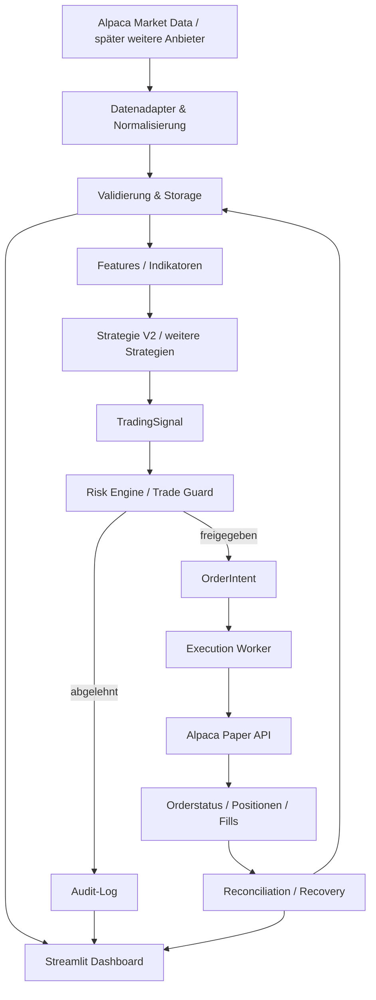

# Aktien-Chatbot – Master-Projektplan & technische Anforderungen

**Dokumentversion:** 1.1
**Stand:** 13. November 2026
**Status:** Verbindliche gemeinsame Planungsgrundlage mit Aufgaben-Checklisten und reproduzierbarer Validierung
**Repository:** privates GitHub-Repository `aktien-chatbot`
**Team:** 2 Entwickler (Person A = Data/Quant, Person B = Risk/Execution/Platform)

> **Zweck:** Dieses Dokument hält Ziel, Anforderungen, Architektur, Schnittstellen, Sicherheitsvorgaben, Aufgabenverteilung, Sprintplanung, Entscheidungen und Abnahmekriterien an einer zentralen Stelle fest. Es dient als gemeinsames Nachschlagewerk. Der tatsächliche Implementierungsstand wird über Git-Commits und Tests nachgewiesen – geplante Bausteine gelten nicht automatisch als implementiert.
>
> **Repo-Abgleich vom 13. November 2026:** Die Struktur und Statusangaben unten wurden mit dem vorhandenen Arbeitsbaum abgeglichen. Der Plan ist eine Zielbeschreibung, keine Behauptung, dass alle geplanten Komponenten bereits existieren.

## 1. Projektziel und Produktumfang

Entwicklung eines **eigenständigen, erweiterbaren Python-Trading-Bots** zur Analyse von US-Aktien und ETFs, zur Erzeugung reproduzierbarer Kauf-/Verkaufssignale sowie zur späteren automatischen Orderausführung **zunächst ausschließlich im Alpaca-Paper-Trading-Konto**. Eine Streamlit-Oberfläche stellt Ergebnisse, Positionen, Risiko- und Betriebsstatus dar. Zwei Entwickler arbeiten über ein privates GitHub-Repository am selben Codebestand.

### 1.1 Verbindlicher MVP-Umfang

- **Handelsstil:** Swing-Trading auf Basis abgeschlossener US-Tageskerzen; Positionen typischerweise mehrere Tage bis Wochen.
- **Erstes Universum:** `AAPL`, `MSFT`, `NVDA`, `AMZN`, `GOOGL`; `SPY` dient als Marktfilter und Benchmark.
- **Marktdaten:** Alpaca (für den bestehenden Prototyp IEX-Feed, mit explizitem Qualitäts-/Lizenzhinweis).
- **Strategie:** Bestehende V2 als reproduzierbare Baseline; Regeln werden nur versioniert und nach Tests verändert.
- **Broker:** Alpaca Trading API mit `paper=True` (erste Stufe nur lesend; spätere Stufe Paper-Orderausführung).
- **Risikokontrolle:** Unabhängige und ausnahmslos zu durchlaufende Risk Engine.
- **Betrieb:** Getrennter Trading-Worker/Runner und Streamlit-UI; UI darf nicht eigenständig Broker-Orders senden.
- **Zusammenarbeit:** Zwei Personen, **direkte Commits/Pushes auf `main`, ohne verpflichtende Pull Requests und ohne Code-Reviews**. Automatisierte Tests bleiben obligatorisch.
- **Live-/Echtgeldhandel:** Nicht Bestandteil des MVP; technisch gesperrt, keine hinterlegte Live-Orderfunktion.

### 1.2 Nicht im MVP / spätere Optionen

- Intraday-/Daytrading mit 5-, 15- und 60-Minuten-Kerzen, anschließend bei Bedarf weitere Intervalle.
- IBKR als zusätzlicher Broker und Datenanbieter; erst nach technischer und wirtschaftlicher Bewertung.
- Europäische Aktien, Short-Trading, Futures, Optionen, CFDs und Hebelprodukte.
- XGBoost/LightGBM und KI-gestützte Zusatzsignale; nur nach Out-of-Sample-Mehrwertnachweis.
- PostgreSQL/TimescaleDB bei gemeinsamer Serverinfrastruktur bzw. wachsender Datenmenge.
- **Stock3 ist weder Anforderung noch Auswahlkriterium.** Eine Integration wird nur erwogen, wenn sie nachweislich sinnvoll, rechtlich zulässig und wirtschaftlich gerechtfertigt ist. Keine Abhängigkeit oder Platzhalterimplementierung erforderlich.

## 2. Architekturentscheidungen (Architecture Decision Records)

| ID | Entscheidung | Grund / Konsequenz |
|---|---|---|
| ADR-001 | Modularer Python-Monolith | Für zwei Entwickler leichter als Microservices zu testen, betreiben und erweitern. |
| ADR-002 | Alpaca Paper als erste Orderplattform | Bestehender funktionierender Zugang; kostengünstiger Entwicklungseinstieg. |
| ADR-003 | Daten-, Strategie-, Risiko- und Ausführungslogik strikt trennen | Austauschbare Anbieter/Strategien; kein ungeprüfter Orderweg. |
| ADR-004 | Swing-Trading zuerst | Tageskerzen und bestehende V2 ermöglichen reproduzierbaren MVP. |
| ADR-005 | Kein LLM als unmittelbarer Orderentscheider | Feste, prüfbare Signal- und Risikoregeln bestimmen Orderzulässigkeit. |
| ADR-006 | Streamlit = Dashboard, Worker = Trading | Seitenaufrufe und UI-Neustarts dürfen keine Orders auslösen. |
| ADR-007 | Entwicklung auf `main` mit direkten Pushes | Teamentscheidung; Synchronisation und Tests ersetzen nicht die Notwendigkeit sauberer Commits. |
| ADR-008 | SQLite lokal, PostgreSQL später | Keine frühzeitige Betriebs-/Datenbankkomplexität. |
| ADR-009 | Stock3 rein optional | Kein technischer oder kommerzieller Zwang zur Nutzung. |
| ADR-010 | Echtgeldmodus fehlt im MVP technisch | Kein versehentliches Senden realer Orders. |

**Änderungen an diesen Entscheidungen** müssen in diesem Dokument mit Datum, Begründung und Folgen dokumentiert werden.

## 3. Systemarchitektur und Datenfluss



**Zentraler Grundsatz:** Daten → Strategie → Signal → Risikoentscheid → Orderplan → später Paper-Ausführung. **Keine direkte Verbindung `OpenAI/Streamlit/Strategie → submit_order`.**

### 3.1 Verantwortlichkeiten und Betriebsregeln

| Baustein | Verantwortung | Externe Orders? |
|---|---|---|
| `data` | Rohdaten abrufen, Herkunft/Zeiten aufzeichnen, normalisieren, validieren | Nein |
| `features` | EMA, ATR, RSI und spätere technische Features ohne Zukunftsdaten | Nein |
| `strategies` | Deterministische Signale und Begründungen mit Versionsnummer | Nein |
| `backtesting` | Historische Orders simulieren, Kosten und Risiken berichten | Nein |
| `risk` | Positionsgröße, Kapital-/Exposure-/Verlust-/Datenregeln, Kill Switch | Nein |
| `execution` | Später alleiniger Paper-Orderweg, Idempotenz, Status und Reconciliation | Nur nach Freigabe, nur Paper |
| `storage` | Kurs-/Signal-/Risiko-/Orderereignisse nachvollziehbar speichern | Nein |
| `monitoring` | Logs, Alarme, Neustart- und Health-Zustand | Nein |
| `app.py` | Benutzeroberfläche, Read-only-Ergebnisse, kontrollierte Einstellungen | Nein |
| `ai` (optional) | Analyse und Erklärungen, kein direkter Orderpfad | Nein |

### 3.2 Datenbank & Nachvollziehbarkeit

**Kurzfristig:** CSV-Historie bleibt als Eingang/Baseline erhalten; SQLite für eventuelle Laufzeit-/Orderprotokolle vorbereiten. **Später:** PostgreSQL als zentraler, transaktionaler Store auf einem gemeinsam betriebenen Server; TimescaleDB nur bei echtem Bedarf.

Geplante logische Entitäten: `instruments`, `market_bars`, `strategy_versions`, `trading_signals`, `risk_decisions`, `order_intents`, `orders`, `executions`, `positions`, `account_snapshots`, `system_events`.

Jede Kursreihe benötigt: Symbol/Instrument-ID, Intervall, Börsenzeitstempel mit Zeitzone, Datenquelle/Feed, OHLCV, Vollständigkeitskennzeichen, ggf. Adjustment-Status. Signale enthalten Bar-Zeitpunkt und Strategieversion. Orders erhalten eindeutige Client-IDs und unveränderliche Statusereignisse.

## 4. Repo-Struktur

Der aktuelle Dateibaum ist ausschließlich in [`trading-system-architektur.md`](../trading-system-architektur.md) gepflegt. Geplante Modulordner werden erst angelegt, wenn sie implementierte und getestete Funktionen enthalten. Lokale CSV-Kursdaten gehören nach `data/market/`, werden nicht versioniert und waren beim letzten Repo-Abgleich nicht vorhanden. `.env`, `*.env` (außer `.env.example`), Backtest-Ergebnisse, Validierungsberichte, virtuelle Umgebungen und Betriebssystemdateien bleiben ebenfalls lokal. Den manuellen Alpaca-Test nicht in automatisierte Tests oder CI aufnehmen.

## 5. Geplante Schnittstellen

Die folgenden Datentypen beschreiben das Ziel und sind **noch nicht implementiert**:

| Typ | Aktueller Vertrag | Bedeutung |
|---|---|---|
| `Side` | `BUY`, `SELL`, `HOLD` | Standardisierte Handelsrichtung |
| `MarketBar` | `symbol`, `timestamp` (timezone-aware), `timeframe`, `source`, `open`, `high`, `low`, `close`, `volume`, `complete` | Einheitliche OHLCV-Kerze |
| `TradingSignal` | `signal_id`, `symbol`, `side`, `bar_date`, `strategy_version`, `reason`, `suggested_stop?` | Strategieentscheidung, **keine Order** |
| `OrderIntent` | `intent_id`, `signal_id`, `symbol`, `side`, `quantity`, `order_type='market'` | Geplanter Auftrag, **noch nicht an Broker übermittelt** |
| `RiskDecision` | Risikofreigabe/Ablehnung inkl. Grund, Stückzahl, geplantes Risiko | Ergebnis eines unabhängigen RiskGuard |
| `BrokerReader` | `read_summary()` | Ausschließlich lesender Paper-Kontozugriff |

**Ergänzungen für Folgesprints:** `BrokerOrder`, `ExecutionFill`, `AccountSnapshot`, `PositionSnapshot`, orderbezogene Idempotenz-ID und explizite Versions-/Zeitfelder. Schnittstellenänderungen müssen mit Tests und Doku konsistent erfolgen.

**Ist-Stand:** `data/csv_loader.py` liest eine CSV-Datei mit pandas als DataFrame ein. Die Funktion validiert derzeit weder Spalten noch Werte und wandelt die Daten nicht in `MarketBar`-Instanzen um. `validation.py` prüft derzeit nur ein normalisiertes Aktiensymbol.

## 6. Funktionale Anforderungen (FR)

| ID | Anforderung | Zielstufe | Akzeptanzbedingung |
|---|---|---|---|
| FR-01 | US-Tageskurse AAPL/MSFT/NVDA/AMZN/GOOGL/SPY laden | Sprint 1 | Alle CSVs lesbar, Datum korrekt, Validierung erfolgreich |
| FR-02 | Abgeschlossene Kerzen, Plausibilität, Duplikate und fehlende Daten erkennen | Sprint 1–2 | Invalides Material wird gemeldet/gesperrt |
| FR-03 | V2-Signal aus vorhandener Strategie erzeugen | Sprint 1 | Wiederholbare `TradingSignal`-Objekte mit Signal-ID/Version |
| FR-04 | Risiko unabhängig von Strategie berechnen | Sprint 1 | Abgelehnte Fälle erzeugen keinen Orderplan |
| FR-05 | Alpaca-Paper-Kontostand/Positionen/offene Orders lesen | Sprint 1 | `paper=True`, keine `submit_order`-Methode im Read-only-Adapter |
| FR-06 | V2-Backtest unverändert reproduzieren | Sprint 1–2 | Vergleich mit Baseline innerhalb dokumentierter Toleranz |
| FR-07 | SPY-Benchmark und Out-of-Sample-Auswertung | Sprint 2 | Gleiches Zeitfenster, Daten-/Dividendenannahmen offengelegt |
| FR-08 | Zulässigen OrderIntent erzeugen | Sprint 1–2 | Eindeutige ID; vollständiger Audit-Trail |
| FR-09 | Paper-Orders korrekt und einmalig senden | Sprint 3 | Idempotenz, Status- und Fill-Nachführung getestet |
| FR-10 | Nach Neustart Orders/Positionen reconciliieren | Sprint 3–4 | Keine unkontrollierte erneute Order |
| FR-11 | Selbstständiger Paper-Trading-Zyklus | Sprint 4 | Worker läuft unabhängig von UI mit Börsenkalender/Healthchecks |
| FR-12 | Dashboard für Signale, Risiko, Orders, Performance | Sprint 4 | Status transparent, keine direkte Orderberechtigung der UI |
| FR-13 | Zusätzliche Strategien/Intraday-Daten | später | Eigenständige Tests und historische Validierung |
| FR-14 | Brokerwechsel möglich | später | Adapter erfüllt identischen Brokervertrag |
| FR-15 | Optionale KI-/News-Komponente | später | Messbarer Mehrwert, kein direkter Orderzugriff |

## 7. Nichtfunktionale Anforderungen (NFR) und Sicherheit

- **NFR-01 Reproduzierbarkeit:** Datenstand, Strategieversion, Parameter, Kostenmodell, Zeitzone und Testzeitraum protokollieren.
- **NFR-02 Keine Look-ahead-Verzerrung:** Tagesabschluss-Signale erst am Folgetag handeln; Intraday nur abgeschlossene Intervalle.
- **NFR-03 Datenqualität:** Fehlende/veraltete/ungültige Kurse und API-Probleme sperren neue Orders.
- **NFR-04 Geheimnisse:** `.env`, Tokens, Broker-/OpenAI-Keys niemals committen, loggen oder im Chat teilen; `.env.example` nur Platzhalter.
- **NFR-05 Paper-only:** Kein Live-Key im ausführenden Prozess, Broker-Client immer `paper=True`; Live-Modus nicht implementiert.
- **NFR-06 Single Writer:** Nur ein Worker darf pro Strategie und Brokerkonto Orders erzeugen.
- **NFR-07 Idempotenz:** Signale/Orderversuche erhalten eindeutige IDs; nach Timeout zuerst Brokerstatus prüfen.
- **NFR-08 Recovery:** Restart-Reconciliation; unbekannte Positionen/Orders blockieren neue Orders bis zur Klärung.
- **NFR-09 Testbarkeit:** Daten, Strategie und Risiko vollständig offline testbar; API-Adapter mockbar.
- **NFR-10 Monitoring:** Strukturierte Logs, Healthchecks, Alarme und dokumentierter Kill Switch.
- **NFR-11 Zugriff:** Beide Entwickler mit eigenen GitHub-Konten; auf gemeinsamem Hosting getrennte Nutzerkonten und zentrale Secret-Verwaltung.
- **NFR-12 Kostenkontrolle:** API-Budget und Anbieterlimits überwachen; kostenlose Dienste können Daten-/Nutzungseinschränkungen haben.

### 7.1 Vorgeschlagene Paper-Risikolimits (konfigurierbare Startwerte, keine Garantien)

| Regel | Vorschlag |
|---|---|
| Geplantes Risiko je Trade | 0,25 % des Kontowerts |
| Geplantes Gesamtrisiko offener Positionen | max. 1,0 % |
| Maximaler Anteil je Position | 20 % |
| Maximal gleichzeitig offene Positionen | 3 |
| Tagesverlustgrenze | 1,0 % |
| Wochenverlustgrenze | 2,5 % |
| Veraltete Daten, offener ungeklärter Orderstatus, Kill Switch | Keine neuen Käufe |
| Stop-Plan | Vor jeder Freigabe erforderlich |
| Echtgeld | Gesperrt |

Ein Stop garantiert keinen maximalen Verlust; Kurslücken und Ausführungen können schlechter als geplant sein. Diese Limits sind **noch nicht sämtlich in Sprint 1 umgesetzt**.

## 8. Broker-/Datenquellenstrategie

### 8.1 Aktuelle Wahl

- **Alpaca Paper Trading** ist der einzige für den MVP eingeplante Broker.
- Konto-/Positionsabfragen werden in Sprint 1 isoliert; Orderversand erst später nach Tests.
- Kostenloser IEX-Marktdatenfeed ist **nicht** der vollständige konsolidierte US-Marktfeed. Datenquelle für Backtests dokumentieren, nicht unkritisch als Marktgesamtvolumen interpretieren.
- Bestehendes `market_data.py` speichert Tagesdaten im Format `data/{SYMBOL}_1day.csv` mit `timestamp_ny`.
- `SPY` ist für den Filter nötig; SPY-Benchmark darf erst nach gleichartigem Datenzeitraum und nachvollziehbarer Adjustierungs-/Dividendenbehandlung interpretiert werden.

### 8.2 Spätere Anbieterentscheidung

IBKR, alternative lizenzierte Marktdaten und weitere Broker nur aufnehmen, wenn Märkte, Preise, Ausführungsqualität, Datenrechte oder Betrieb es rechtfertigen. **Stock3 nicht priorisieren** und keine Stock3-API als Voraussetzung formulieren.

## 9. Backtesting-Qualitätsstandard

- V2 zunächst als unveränderte Baseline archivieren: im bisherigen Test rund **50.000 USD Startkapital**, **+0,35 % Rendite**, **−4,46 % maximaler Drawdown**, **20 abgeschlossene Trades**; Zeitraum/Ergebnisse anhand der jeweiligen Daten neu reproduzieren.
- Bisherige Analyse zeigt geringe durchschnittliche Kapitalbindung und starke Abhängigkeit von einzelnen Gewinntrades. Kein Nachweis robuster Profitabilität.
- Signale immer nur aus bis dahin bekannten Daten erzeugen; Ausführung zeitlich erst danach.
- Kosten, Spread, Slippage, Gap-Risiko, Stop-Reihenfolge, Teilfills und fehlende/angepasste Daten explizit modellieren.
- Buy-and-Hold/Benchmark mit gleichem Zeitraum vergleichen, **nicht** als risikogleiche Strategie darstellen, wenn das Exposure unterschiedlich ist.
- Train/Test-Trennung und Walk-forward-Prüfungen; keine Parameteroptimierung auf der späteren Testperiode.
- Report: Rendite, maximale Drawdown, Trefferquote, Profit Factor, Expectancy, Holding Days, Exposure, Kosten, Einzeltitelbeiträge, offene Positionen.
- Nicht nur profitable Tests zählen: schwache Phasen und fehlgeschlagene Versuche dokumentieren.

## 10. Aufgabenverteilung für genau zwei Personen

**Person A – Data/Quant:** Marktdaten, Zeitreihen, Indikatoren, Strategien, Backtests, Benchmarks, Daten-/Strategietests.
**Person B – Risk/Execution/Platform:** Risikoprüfung, Konfiguration, Brokerabstraktion, Konten-/Orderstatus, später Orderausführung, Persistenz/Betrieb und technische Sicherheit.

Beide schreiben Code und Tests. **Kein Pflicht-Code-Review, keine Pull Requests**. Gemeinsame Schnittstellen (`models.py`, `interfaces.py`, Abhängigkeiten) immer vor parallelen Änderungen kurz absprechen. Bei Kapazitätsunterschieden einzelne begrenzte Aufgaben zwischen A und B umverteilen.

### 10.1 Direkter GitHub-Workflow (vereinbart)

1. `git status` – keine unbeabsichtigten Änderungen; `validation_reports/` in `.gitignore` ergänzen.
2. `git pull --ff-only origin main` – **vor** Arbeit an einem sauberen `main`.
3. Ausschließlich eigene/abgestimmte Dateien bearbeiten.
4. `python -m pytest -q` – Tests vor Push; auf Windows bevorzugt `\.venv\Scripts\python.exe -m pytest -q`.
5. Konkrete Pfade mit `git add <datei>` stagen, `git diff --cached` prüfen.
6. `git commit -m "Quant: ..."` bzw. `git commit -m "Platform: ..."`.
7. `git pull --rebase origin main` und `git push origin main`.
8. Bei Konflikt stoppen, Ursache gemeinsam klären; **kein `git push --force`**.

Direkte Commits auf `main` sind eine bewusste Teamentscheidung; automatisierte Tests/CI sollen Fehler früh auffangen, ersetzen aber keine sorgfältige Prüfung kritischer Änderungen.

### 10.2 Datei-Verantwortlichkeit

| Person A | Person B | Nur nach Abstimmung |
|---|---|---|
| `data/*`, `analysis/*`, `signals/*` | `risk/*`, `execution/*`, `monitoring/*` | `core/models.py`, `core/config.py` |
| `backtesting/*` | `core/storage.py` | `requirements.txt`, `pyproject.toml`, `app.py`, `runner.py`, gemeinsame CI |
| Daten-/Strategietests | Risiko-/Executiontests | Schnittstellen-/Integrationstests |

## 11. Sprints und konkrete Arbeitspakete

### Sprint 1 – V2 konsolidieren, Interfaces, Risiko/Broker trennen **(aktuell)**

**Gemeinsam – Start:** Implementierten Repo-Stand sichern, `.env` schützen, Installation und vorhandene CI prüfen.

**Person A – Data/Quant**

- [ ] **A1** · Alle 6 Tages-CSV-Dateien über `data/csv_loader.py` laden/validieren (AAPL, MSFT, NVDA, AMZN, GOOGL, SPY).
- [ ] **A2** · V2 über `strategies/v2_bridge.py` und `TradingSignal` ansprechen.
- [ ] **A3** · V2-Backtest reproduzieren; Kennzahlen, SPY-Vergleich und Datenannahmen dokumentieren.
- [ ] **A4** · Daten-/Strategietests für Leerdateien, Duplikate, Zeitstempel und zukünftige Daten erweitern.

**Person B – Risk/Execution/Platform**

- [ ] **B1** · `risk/guard.py` gegen Grenzfälle und Fail-Closed-Szenarien testen.
- [ ] **B2** · `execution/alpaca_readonly.py` mit lokalen **Paper**-Keys nur lesend prüfen.
- [ ] **B3** · Positionen, Kaufkraft, offene Orders und Handelseinschränkungen korrekt erfassen.
- [ ] **B4** · `.env.example`, `.gitignore`, CI/pytest, dokumentierte Einstellungen und Fehlerfälle absichern.

**Gemeinsam – Abnahme**

- [ ] Chatbot, CSV-Import, Datenqualität und Tests sind nachvollziehbar und offline prüfbar.
- [ ] `python -m unittest discover -s tests -v` ist erfolgreich.
- [ ] Ein zukünftiger Dry-Run zeigt Signale/Orderpläne, ohne Broker-Orders zu senden.
- [ ] Ein zukünftiger Broker-Leseadapter ist isoliert und ausdrücklich auf Paper beschränkt.
- [ ] Beide wissen, wer welche Schnittstellen verantwortet; Stand direkt auf `main` synchronisiert.

### 11.1 Aufgabenprüfung

Checkboxen dokumentieren den manuellen Projektstatus. Der vorhandene CI-Workflow führt Unit-Tests aus; eine aufgabenbezogene Prüfung, ein `validate_task.py`-Skript und JSON-Berichte existieren derzeit nicht. Aufgaben dürfen erst abgehakt werden, wenn die zugehörigen Funktionen und Tests tatsächlich implementiert und geprüft sind.

### Sprint 2 – Datenpipeline, Backtest-Härtung und Risikopolitik

**Person A – Data/Quant**

- [ ] **S2A1** · Marktdatenadapter, einheitliche `MarketBar`-Transformation und Datenqualitätsprüfungen implementieren.
- [ ] **S2A2** · Börsenkalender, Datenlücken, Splits/Dividenden und Aktualisierungsregeln nachweisbar behandeln.
- [ ] **S2A3** · Backtest mit SPY-Benchmark, Out-of-Sample-Auswertung und reproduzierbarem Bericht vervollständigen.

**Person B – Risk/Execution/Platform**

- [ ] **S2B1** · RiskGuard um Exposure-, Tages-/Wochenverlustlimits, Kill Switch und Fail-Closed-Fälle erweitern.
- [ ] **S2B2** · Risikoentscheidungen, Signale und Audit-Ereignisse revisionsfähig speichern (SQLite).
- [ ] **S2B3** · Unit- und Integrationstests für Blockierungen und Grenzwerte ergänzen.

**Gemeinsame Abnahme:** Auf identischen Daten erzeugt die Strategie dieselben Signale; das Risikomodul gibt bei fehlenden/ungültigen Daten niemals einen Orderplan frei.

### Sprint 3 – Automatische **Paper**-Orderstrecke

**Person A – Data/Quant**

- [ ] **S3A1** · Nur abgeschlossene neue Kerzen verarbeiten, stabile eindeutige Signal-IDs vergeben.
- [ ] **S3A2** · Backtest-Signalzeitpunkt und Live-Paper-Signalzeitpunkt vergleichen und dokumentieren.

**Person B – Risk/Execution/Platform**

- [ ] **S3B1** · Alpaca-Paper-Executor nach Risikofreigabe implementieren (`paper=True`, kein Live-Pfad).
- [ ] **S3B2** · Client-Order-IDs, Timeout-Behandlung, Teilfills und doppelten Versand testen.
- [ ] **S3B3** · Positionen, offene Orders, Wiederanlauf und Brokerabgleich implementieren.

**Gemeinsame Abnahme:** Kein Order-Duplikat bei Zeitüberschreitung/Neustart; keine Order ohne Risk-Approval. Ausführung ausschließlich auf Paper.

### Sprint 4 – Vollautomatischer Paper-Betrieb

**Person A – Data/Quant**

- [ ] **S4A1** · Signale, Performance und Datenqualität im Dashboard darstellen.
- [ ] **S4A2** · Strategie- und Backtest-/Paper-Abweichungen dokumentiert überwachen.

**Person B – Risk/Execution/Platform**

- [ ] **S4B1** · Eigenständigen Worker mit Börsenkalender, Single-Writer-Schutz und Scheduler betreiben.
- [ ] **S4B2** · Monitoring, Fehlersperre, Alarmierung, Kill Switch und Recovery-Tests nachweisen.

**Gemeinsame Abnahme:** Mehrwöchiger beobachteter Paper-Betrieb ohne kritische Order-/Datenfehler; UI bleibt ohne direkten Orderzugriff.

### Sprint 5 – Optionale Erweiterungen (nach MVP)

- [ ] **S5A1** · Intraday-Daten und neue Strategien nur mit eigenständiger historischer Validierung einführen.
- [ ] **S5B1** · Zusätzliche Broker/Marktdatenanbieter ausschließlich über Austauschadapter integrieren.
- [ ] **S5AB1** · Bei Bedarf ML/KI und gemeinsames Hosting anhand dokumentierter Qualitäts-/Kostenkriterien prüfen.

**Status Sprint 2–5:** Dies sind geplante Arbeitspakete; aufgabenbezogene automatische Prüfungen sind noch nicht implementiert. Eine Stock3-Anbindung ist nicht erforderlich.

## 12. Startanweisungen

### 12.1 Voraussetzungen

- Python 3.10 oder neuer.
- Benötigte Bibliotheken mit `python -m pip install -r requirements.txt` installieren.
- Zugangsdaten bei Bedarf lokal in `.env` ablegen; keine echten Schlüssel in `.env.example` eintragen.
- CSV-Dateien können lokal unter `data/market/` abgelegt werden. Im geprüften Arbeitsbaum waren keine CSV-Dateien vorhanden.

### 12.2 Befehle

```bash
python -m pip install -r requirements.txt
python -m unittest discover -s tests -v
streamlit run app.py
```

**Sicherheitsregel:** `test_alpaca.py` kann nach Bestätigung eine Paper-Order absenden. Nicht als Teil automatisierter Tests oder CI ausführen.

### 12.3 Unmittelbarer nächster gemeinsamer Meilenstein

Zunächst CSV-Schema und Validierungsregeln festlegen. Danach Loader-Tests für gültige und fehlerhafte Dateien hinzufügen; echte CSV-Datensätze bleiben lokal und werden nicht committed.

## 13. Geprüfter Implementierungsstand (13. November 2026)

| Bereich | Vorhanden | Offen |
|---|---|---|
| Streamlit-Chatbot | `app.py` mit Yahoo-Finance-Daten und OpenAI-Analyse | Laufzeit-/API-Verhalten nicht in dieser Repo-Prüfung validiert |
| Alpaca | Manueller Paper-Kauf-Test in `test_alpaca.py` | Kein isolierter Read-only-Adapter; nicht automatisiert ausführen |
| CSV-Daten | Ein einfacher CSV-Loader | Keine CSV-Datensätze vorhanden; Datenqualität/Schema-Validierung fehlt |
| Trading-Bot-Code | Symbolprüfung und `data/csv_loader.py` | Modelle, Strategie, Risiko, Backtest und Runner fehlen |
| Tests/CI | Symboltests und `.github/workflows/tests.yml` | Daten- und weitere Funktionstests ergänzen |
| Secrets | `.env.example`; lokale `*.env` werden ignoriert | Keine Secrets in Git oder CI hinterlegen |
| Live-Trading | Nicht Teil des bestehenden Codes dieses Pakets | Nicht implementieren; MVP bleibt Paper-only |

## 14. Definition of Done – allgemeingültig

Eine Aufgabe gilt erst als abgeschlossen, wenn **(a)** die spezifizierte Funktion existiert, **(b)** der relevante Test reproduzierbar bestanden ist, **(c)** Fehler und Grenzen dokumentiert sind, **(d)** kein geheimer Schlüssel eingecheckt wurde und **(e)** der Stand im gemeinsamen `main` liegt. Bei Schnittstellenänderungen müssen alle abhängigen Tests ebenfalls erfolgreich sein.

## 15. Offene Entscheidungen / technische Risiken

1. **Datenqualität:** IEX-Feed versus konsolidierte US-Daten, Volumen-/Slippage-Einfluss, Datennutzungsrechte.
2. **Adjustments:** Rohkurse, Splits und Dividenden müssen zwischen Historie, Strategie und Benchmark konsistent behandelt werden.
3. **Backtest-Ausführung:** Intraday-Abfolge innerhalb von Tageskerzen ist nicht erkennbar; Gap-/Stop-Annahmen dokumentieren.
4. **Kostenmodell:** Brokergebühren, Spread, Slippage und Steuern für die jeweilige Handelsphase transparent ausweisen.
5. **Gemeinsamer Betrieb:** Welcher Rechner/Server läuft dauerhaft? Wer ist für Betrieb und Störungen verantwortlich?
6. **Kapital-/Kontentrennung:** Für späteren gemeinsamen Betrieb festlegen, ob ein oder mehrere Paper- und ggf. Live-Konten verwendet werden; pro Konto nur ein aktiver Executor.
7. **Risikolimits:** Anfangswerte empirisch und technisch validieren, nicht als Garantie behandeln.
8. **Strategiequalität:** Eine positive Backtestperiode reicht nicht als Robustheitsnachweis.
9. **Rechtliche Verantwortung:** Bei Nutzung außerhalb reiner Eigenverwaltung oder für Dritte regulatorische Anforderungen gesondert prüfen.

## 16. Dokumentationspflege

- `trading-system-architektur.md` ist die zentrale Übersicht für Struktur und Modulverantwortlichkeiten.
- `docs/PROJECT_PLAN.md` enthält Anforderungen, Status und Sprintplanung.
- `README.md` enthält Einstieg, Installation, Start und Testbefehle und verlinkt auf beide Dokumente.
- Entschiedene Architekturänderungen: Änderungstabelle unten ergänzen.
- Aufgaben werden in diesem Markdown per Checkbox nachgehalten. Derzeit existiert nur ein CI-Workflow für die Unit-Tests; ein separater Aufgabenprüf-Workflow und `scripts/validate_task.py` sind nicht vorhanden.
- Bei Widerspruch zwischen Plan und ausführbarem Code **nicht** stillschweigend annehmen, dass der Plan bereits implementiert ist. Den Unterschied als offene Aufgabe erfassen.

### Änderungsprotokoll

| Datum | Version | Änderung |
|---|---|---|
| 2026-11-11 | 1.1 | Sprint-1-Checkboxen mit Prüf-Links, validierbaren Aufgaben-IDs, Workflow und Berichtskonzept. |
| 2026-11-11 | 1.0 | Gemeinsamer Masterplan: Swing-MVP/Alpaca-Paper, Stock3 optional, direkte Commits auf `main`, Architektur, Verträge, Aufgaben und Sprints dokumentiert. |

---

**Nächste praktische Aktion:** CSV-Schema und Datenqualitätsregeln festlegen, anschließend den Loader samt Offline-Tests erweitern. Bis echte Datensätze geprüft wurden, keine Aussage über Datenvollständigkeit oder Backtest-Ergebnisse treffen.
